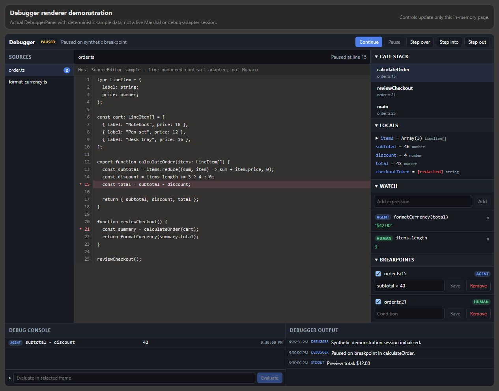

# Marshal Agentic Debugger

Marshal Agentic Debugger provides Debug Adapter Protocol session control,
breakpoints, stepping, stack and variable inspection, evaluation, and a React
debugger panel for JavaScript/TypeScript, Python, and C#/.NET.

The repository contains a Marshal Runtime extension, native host adapter,
standalone CLI, MCP server, and debugger UI. The currently supported standalone
workflow is attaching to an existing Node.js inspector session.



*Actual debugger renderer with synthetic data and a sample host source editor;
not a live Marshal or DAP session or a recording.*

## Requirements

- Node.js 18 or newer
- A matching debug adapter:

| Target | Adapter |
| --- | --- |
| JavaScript/TypeScript | js-debug |
| Python | debugpy |
| .NET Core / .NET 5+ | netcoredbg |
| .NET Framework 4.x on Windows | clr-debug |
| Optional .NET fallback | vsdbg, subject to its license restrictions |

Adapter downloads do not run during `npm install`.

## Build and install in Marshal

For a Marshal Runtime source checkout, place this repository at:

```text
<marshal-agent-runtime>\extensions\<repository>
```

Then build it:

```powershell
npm ci
npm run build
```

The build emits `dist\runtime-extension.cjs` and the bundled native host at
`dist\runtime\native-host.mjs`. The package exposes the latter as `./native`.

Open **Marshal > Plugins**, refresh the Runtime catalog, find
`@marshal/agentic-debugger-extension`, then explicitly **Install** and
**Enable** it. Discovery only publishes a catalog candidate; it does not
install, enable, activate, or execute the extension.

Usable debugging additionally requires the host service
`marshal.agentic-debugger.host-adapter`, a renderer for
`marshal.agentic-debugger.v1`, and editor integration. Without the adapter,
operations fail with `WORKER_UNAVAILABLE`.

## Provision adapters

Provision js-debug explicitly:

```powershell
npm run provision:adapters
```

Opt in to vsdbg on Windows PowerShell:

```powershell
$env:AGENTIC_INSTALL_VSDBG = "1"
npm run provision:adapters
Remove-Item Env:\AGENTIC_INSTALL_VSDBG
```

Python and modern .NET adapters remain external:

```powershell
python -m pip install debugpy
$env:AGENTIC_PYTHON_PATH = "C:\path\to\.venv\Scripts\python.exe"
$env:AGENTIC_NETCOREDBG_PATH = "C:\path\to\netcoredbg.exe"
```

To create a package archive, provision any adapters that must be included
before packing:

```powershell
npm pack
```

`prepack` rebuilds the package. The normal archive includes the `./native`
resource; an `adapters` directory is included only when it exists.

## Working workflow: attach to Node.js

In one terminal:

```powershell
node --inspect-brk=9229 .\tests\integration\helpers\test-programs\js\basic.js
```

In another:

```powershell
node .\dist\cli.mjs attach --language javascript --type node --address 127.0.0.1:9229
```

Use the returned session with `threads`, `breakpoint set`, `continue`,
`callstack`, `variables`, `evaluate --safe-mode`, and `terminate`. CLI output is
structured JSON.

## Configuration

| Variable | Purpose |
| --- | --- |
| `AGENTIC_JSDEBUG_PATH` | js-debug installation or entrypoint |
| `AGENTIC_PYTHON_PATH` | Python interpreter used for debugpy |
| `AGENTIC_NETCOREDBG_PATH` | netcoredbg executable |
| `AGENTIC_CLR_DEBUG_PATH` | clr-debug executable |
| `AGENTIC_VSDBG_PATH` | vsdbg executable |
| `AGENTIC_SYMBOL_PATH` | Semicolon-separated symbol paths for vsdbg |
| `AGENTIC_DEBUGGER_LOG_LEVEL` | Debugger log level |

The library parser also accepts audit-log, timeout, session-limit, attach,
redaction-pattern, and redaction-enable variables. The CLI and MCP entrypoints
do not currently load that parser. There is no JSON configuration-file loader.

## Current limitations

- Standalone `launch` does not select and start the registered adapter
  correctly.
- MCP `launch` and `attach` ignore the resolved adapter transport.
- Standalone browser/CDP attach is not validated and currently times out.
- vsdbg is opt-in and is not promised as a standalone supported path.
- The Marshal debugger panel has not been validated in a live host.

Runtime integration details are in
[the Marshal extension guide](docs/marshal-runtime-extension.md). The injectable
service contract is [`contracts/IDebugger.d.ts`](contracts/IDebugger.d.ts).

## License

[MIT](LICENSE)
